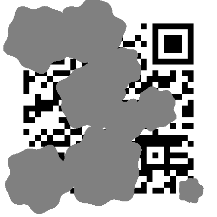
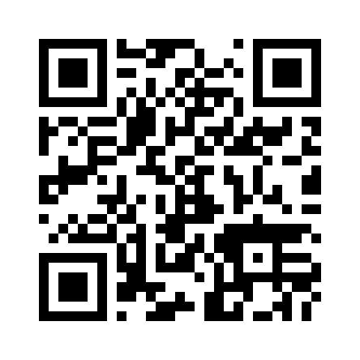

# QRevy

[English](README.md) | 日本語

QRevyは、通常のリーダーでは読み取れない損傷したQRコードを、オフラインで修復するAndroidアプリです。画像や個々のセルを調整し、修復候補を比較して、修復の根拠を確認できます。

Android 8.0以降と、QR Code Model 2のバージョン1～40に対応しています。Model 1、Micro QR、rMQRには対応していません。このリポジトリには完成したiOSアプリは含まれていません。

修復結果が元の内容と一致する保証はありません。重要な内容は、別の手段でも確認してください。

## 修復例

| 修復前 | 修復後 | 補完・訂正箇所 |
| --- | --- | --- |
|  |  |  |

841セル中503セル（59.8%）が消失した合成例です。[画像入力と試す手順](docs/examples/bullet-holes/README.ja.md)を参照してください。

## 使い始める

1. 画像やテキスト行列を読み込むか、カメラで撮影します。
2. 読み取りや自動修復の結果を確認します。初期状態では簡易自動修復が有効で、通常の読み取りに失敗すると実行されます。
3. 必要なら詳細解析で格子や個々のセルを調整し、「修復」を実行します。候補を確認してから、復号したテキストのコピーや修復したQR画像の保存を行います。作業を保存して後で再開することもできます。

操作や設定の詳細は[ユーザーガイド](docs/USER_GUIDE.ja.md)を参照してください。

## ビルドとインストール

このリポジトリからビルドするには、JDK（Java開発キット）17とAndroid SDK（ソフトウェア開発キット）を用意し、SDK Platform 37をインストールしてください。その後、次のコマンドを実行します。

```bash
bash bootstrap-wrapper.sh
bash scripts/verify-wrapper.sh
./gradlew :androidApp:assembleDebug
```

生成されたAndroidパッケージ（APK）`build/androidApp/outputs/apk/debug/androidApp-debug.apk`を端末にインストールしてください。

## 関連文書

- [修復結果の見方](docs/RECOVERY_RESULT_FIELDS.ja.md)
- [QRevyの修復戦略](docs/RECOVERY_STRATEGY.ja.md)
- [テキスト行列テンプレート](templates/text-matrices/README.ja.md)
- [プライバシー](PRIVACY.ja.md)
- [セキュリティ](SECURITY.ja.md)

## ライセンス

[Apache License 2.0](LICENSE)で公開しています。著作権表示、商標、依存ライブラリのライセンスは、[権利表示](NOTICE.md)と[サードパーティーの権利表示](THIRD_PARTY_NOTICES.md)を参照してください。
