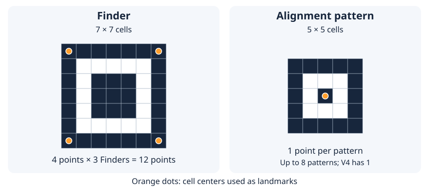

# QRevy recovery strategy

English | [Japanese](RECOVERY_STRATEGY.ja.md)

QRevy combines image readings, QR structure, and error correction to find recovery candidates for damaged Model 2 QR codes. This document explains how candidates are produced and which conditions cause them to be rejected.

The processing flow is:

`Establish a grid → Read cells → Select a format → Repair codewords → Combine blocks → Validate the complete QR code`

For operations, see the [User Guide](USER_GUIDE.en.md). For diagnostic fields and cell explanations, see [Understanding repair results](RECOVERY_RESULT_FIELDS.en.md).

## Scope of the two repair modes

Both modes use a common recovery core and candidate-validation rules. Each mode selects its own grids, assumptions, and search methods.

| Mode | Grid and decoding conditions | Search and results |
| --- | --- | --- |
| Detailed analysis | Uses the selected grid, version, orientation, manual edits, and settings. Optional fine-tuning explores nearby grids without changing the selected version or orientation. | Follows the search order in section 4. Retains validated candidates even when the search is unfinished. |
| Quick automatic repair | After ordinary reading fails, automatically tries image orientations, corrected grids, and applicable assumptions. Its execution conditions are recorded separately from detailed-analysis settings. | Uses the methods, time allowances, and success conditions in section 10. Reports success only after a trial leaves one candidate and completes the required checks. |

Sections 1–3 describe input evidence, geometry, and format handling; grid selection and fine-tuning on the settings screen belong to detailed analysis. Section 4 gives the detailed-analysis search order. Sections 5–8 explain the available calculation and validation methods, section 9 explains outcomes and limits, and section 10 specifies which methods quick automatic repair uses and how it runs them.

## 1. Readings and assumptions used in calculation

A cell (module) is one square in a QR code. Cell values are stored as `0 / 1 / ?`, where `?` means unknown. Values read from the image may still contain errors.

The image reading or imported matrix with manual edits applied is kept as the input before any values inferred from structure or temporary search assignments are added. Results are compared against this state, called the **starting input**.

A `*` mark prioritizes trying `0 / 1` combinations for the marked unknown cells. Their input values remain `?`; values tried during calculation are excluded from input-agreement comparisons.

### Value sources, fixed cells, and comparison inputs

For each cell, the app distinguishes the input value, intermediate filling and correction, and the final value.

For example, if structure fills a cell with `0` and error correction then changes it to `1`, the record preserves that sequence: “filled with `0` from structure,” then “changed to `1` by error correction.”

A candidate whose value differs from a fixed `0 / 1` cell is rejected unless correction of fixed values is enabled. Tentative edits and image readings can be corrected within the error limits. When correction of fixed values is enabled, the input still records the original values and their Fixed designation.

An **error-correction code (ECC)** provides information for detecting and correcting errors in the data. For data and ECC bits, the app compares candidate values with the starting input.

| Value | Included in comparison? | Reason |
| --- | --- | --- |
| Known data/ECC bits in the starting input | Yes | They are input values obtained from image readings or manual edits. |
| Starting `?` or `*` | No | The input value is unknown. |
| Values filled from structure | No | They are inferred values, not values in the starting input. |
| Values tried during search | No | They are temporary assignments used to test combinations. |

If a known starting value is changed during calculation, the comparison still uses the original value. For example, if a starting `0` is changed to `1` to fit the structure and the final result is `1`, that counts as one mismatched bit. If the starting value is `?`, the cell is excluded from comparison even if it is filled with `0` and ends up as `1`.

Raising an error limit alone does not permit correction of fixed values. To include fixed values among those that may be corrected, enable the setting that allows correction of fixed values.

## 2. Establishing the grid and reading cells

When an image is imported, the app estimates the version, which determines the grid size, and the positions of the QR code's four corners in the image.

In detailed analysis, the user selects the grid to read before repair. When automatic fine-tuning is enabled, repair explores sampling positions around the selected reference grid. The selected version and the assignment of the QR code's top-left, top-right, and bottom-left corners, called its logical orientation, stay unchanged. Quick automatic repair selects grids and orientations as described in [Image correction and trial order](#image-correction-and-trial-order).

Recovery requires at least one finder pattern (**Finder**) to be assigned a top-left, top-right, or bottom-left role. Recovery can be attempted even when only one Finder is visible.

The app samples near each cell's center, shifting the sampling position slightly. If the readings consistently classify as black or white, the cell becomes `0 / 1`. If the classification changes or black and white cannot be distinguished, the cell becomes unknown (`?`).

For a manually edited cell, the entered `0 / 1 / ?` replaces the value sampled from the image.

### Initial grid estimation and sampling refinements

Initial estimation uses the QR detection library ZXing-C++ to detect the QR code's outer boundary in the image. The app builds a grid from that boundary and checks whether Finders and other patterns can be read at their expected positions and with their expected shapes.

If that grid cannot be accepted, the app estimates a grid from the repeating cell spacing, then considers an estimate using two Finders if necessary. It may decline an estimate when, for example, boundaries of different QR codes are detected or normal and inverted readings give conflicting estimates. Text decoded by the detection library is not used as the recovery result.

A **separator** is the white border around a Finder. A **timing pattern** alternates black and white to indicate cell spacing. The **quiet zone** is the white margin surrounding the entire QR code.

When normal and inverted periodicity estimates conflict, the app checks each proposed grid against three Finders, their separators, and the timing patterns. It can retain the one structurally verified grid when an inverted quiet zone has produced a false larger grid. If both grids pass or neither passes, the conflict remains unresolved. This check preserves the selected periodicity corners and does not automatically assign Finder roles. An uncontested periodicity estimate can still be used when Finders are damaged or missing.

For nearly frontal symbols of version 2 or higher, missing dark cells along an outer edge need not prevent initial estimation. If the repeated spacing and boundary phase are clear but the grid cannot fit within the observed dark extent, a surviving Finder can anchor an extension. Its shape and separator must agree with the grid, at least one timing axis must provide sufficient known evidence, and known timing cells must not contradict it. Gray unknown cells provide no positive evidence. The grid must contain the observed dark extent and keep every outer module center inside the image; distinct supported grids remain ambiguous. This geometry fallback is shared by quick automatic repair and detailed analysis. It does not alter sampling thresholds or automatically assign Finder roles.

Ordinary grid candidates use a projective transformation to map the four corners to cell positions in the image. This models a flat surface viewed at an angle. The optional distortion candidates described below add non-rigid displacement for curved surfaces.

### Selecting a corrected grid before repair

In detailed analysis, grid correction using the Levenberg–Marquardt (LM) method is enabled by default for new work. When no curved grid is already selected, it uses the confirmed four-corner grid, version, and logical orientation as a single starting grid. Enabling LM with a selected curved grid uses that grid for joint optimization, as described below. The image must provide enough independent pattern evidence for the fit.

The app projects the black and white patterns of the Finders, their white separators, and the alignment patterns onto the image. An **alignment pattern** is a small pattern used to align the grid. The LM method adjusts all eight parameters of the projective transform together to match these patterns to observed brightness. For QR Code version 1, the fit uses only Finders and their separators. Timing patterns are excluded from the LM objective. A fit is accepted only when the objective improves and the image measurements constrain all eight parameters.

The original corners remain available separately from the selected correction. Switching correction off restores that reference, without changing manual cell values or fixed-cell constraints. Geometry edits invalidate the LM selection and pending calculations. The selected mapping supplies the displayed grid and cell readings and is saved for recovery and session restoration.

### Automatic fine-tuning around the selected grid

In detailed analysis, with automatic fine-tuning off, repair uses the grid selected on the settings screen, with the exception of [original-grid verification](#image-correction-and-trial-order). With it on, repair generates and tries the neighborhood, alignment-correction, and LM-correction candidates described below, using that grid as the reference. The search reference is the selected LM-corrected grid when present, otherwise the specified four-corner grid.

The basic refinement candidates are:

| Transformation | Candidate count |
| --- | ---: |
| Specified grid | 1 |
| Horizontal, vertical, and diagonal translations | 8 |
| Expansion and contraction | 2 |
| Moving one corner inward or outward | 8 |
| Total | 19 |

The reference displacement is 0.6 cell widths. When exactly one Finder role is assigned, the app also tries small clockwise and counterclockwise rotations around the corresponding corner. These two additions give at most 21 grid candidates. Each translation, scaling, or rotation is applied separately to the specified grid.

For version 2 and above, an alignment pattern can add at most one corrected grid for each grid candidate. If its observed position differs from its predicted position by 0.1–1.25 cell widths, the nearest grid corner is moved. Corrections that substantially worsen agreement with the timing pattern are rejected. The app tries both the original grid and any accepted correction.

These steps yield at most 38 candidates per polarity. With exactly one assigned Finder role, rotations about the corresponding corner bring the maximum to 42.

Automatic fine-tuning also applies LM fitting using up to four starting grids selected from these candidates. Timing-pattern agreement helps select the starts. This search can still generate an LM candidate when the optional correction before repair is off.

If the fit improves and yields a grid distinct from the other candidates, the app adds that grid as one more candidate. The generated candidates per polarity therefore number **at most 39**, or **at most 43** with exactly one assigned Finder role. A separately selected preview grid may add one more attempt. Distortion correction has a separate candidate budget.

When fine-tuning is enabled, repair tries the selected preview grid first, if present, followed by the LM-fitted grid, the specified grid and its neighborhood/alignment corrections, and finally additional distortion-correction grids. Duplicate grids are tried only once.

### Distortion correction

Experimental distortion correction uses landmarks from all three Finders and other patterns to build grids that follow curvature. The orange dots below mark the landmarks. The left diagram shows one Finder; the right shows one alignment pattern.

1. **Obtain twelve points from the Finders.** Search for nested dark/light/dark Finder outlines at multiple image sizes, with maximum side lengths of 384, 640, and 960 pixels. For each Finder, use **the centers of the black cells at the four corners of its 7×7 grid: four points per Finder, twelve across all three Finders**. Calculate these four cell-center positions in the image from the detected outline corners.
2. **Bend the grid using these twelve points.** First fit a projective transformation, then use a **thin-plate spline (TPS)** to smoothly interpolate the remaining displacement. This transformation determines where each cell is sampled.
3. **Refine using additional patterns.** For alignment patterns, use **the center of the black central cell in the 5×5 pattern: one point per pattern**. Match the pattern near its predicted position and add up to eight usable observations. V4 has one such point, giving thirteen points together with the twelve Finder landmarks. Then track the alternating black and white timing patterns, adding up to sixteen observations per axis. Timing observations receive softer constraints than the other landmarks.

Retain candidates from each stage for comparison, and reject maps that fold over or have excessive displacement or local stretching. Local Finder-template matching also supplies candidates. If contour extraction reaches its memory limit, the app reports that part of correction search is unfinished and continues local pattern matching and ordinary repair.

#### Preview selection and detailed-analysis search

The settings screen computes up to twelve correction candidates from the selected reference grid and prioritizes them by the number of image-derived unknown cells in data/error-correction codewords, timing patterns, and format information. Finder patterns, separators, alignment patterns, version information, and remainder bits are excluded. Manual edits do not affect this count. Timing-pattern agreement and other image checks break ties.

The reference is the selected LM-corrected grid, or the specified four-corner grid when LM correction is off. Grid lines, cell values, cell selection, and repair share the selected candidate. The corner handles edit the underlying grid before distortion correction; landmarks are measured again when the adjustment finishes. The selected candidate is also saved in the session.

With “Automatically fine-tune sampling position” enabled, repair attempts recovery in this order: the selected preview grid, the LM-fitted grid, and the specified grid with its neighborhood/alignment corrections. Grids that have not been selected or generated are skipped.

With distortion correction enabled, it selects up to four ordinary grids based on agreement with the timing pattern and other image checks. It applies correction first to the LM-fitted grid, if available, and then to each selected ordinary grid. Each grid serves as the reference for generating up to twelve correction candidates, for a total of at most 60 additional candidates per polarity (48 when no LM-fitted grid is available).

#### Joint LM and curvature optimization

When both LM correction and distortion correction are enabled, the selected distortion candidate is refined by jointly adjusting the projective transform and smooth curvature. If no distortion candidate is available, refinement starts from the LM grid. A result replaces the candidate only when all three conditions hold:

- The optimization converges.
- The sum of squared brightness residuals decreases on the same fine-scale observation points, excluding regularization.
- The image-derived unknown count does not increase in the cells used for candidate ranking.

With automatic thresholds, thresholds are estimated separately for the original and refined grids. Invalid or excessively deformed grids are rejected. If the acceptance conditions are not met, the original candidate remains.

The fit uses Finders, separators, and alignment patterns, without timing-pattern targets, payload bits, or manual edits. Automatic fine-tuning applies the same replacement to curvature searches starting from an LM fit or a selected LM reference.

| Operation | Starting grid for joint optimization |
| --- | --- |
| Curved correction ON, LM OFF → both ON | The currently selected curved grid; preserve its shape and candidate selection. |
| Curved correction OFF, LM ON → both ON | Generate curved candidates from the LM grid, rank by the unknown-cell count described above, and use the top candidate. |
| Select another curved candidate with both ON | The selected curved grid if it has not been evaluated; otherwise reuse its completed result. |

Refinement runs in the background. Only the top candidate is refined when candidates are generated; other candidates are refined when selected. Switching candidates or changing geometry invalidates pending results. Each candidate's completed refinement attempt is reused during the same preview, including when no acceptable improvement was found.

After refinement, candidates are stably sorted by the same image-derived unknown count. The selected grid and completed refinement attempts follow their candidates when the order changes. Manual cell edits and fixed-cell constraints remain unchanged.

### Measuring brightness and marking unknown cells

For each cell, brightness is measured at a 3×3 set of points offset by −0.16, 0, and +0.16 cells along each axis, and their mean is calculated. The entire set is then shifted by −0.1, 0, and +0.1 cells along each axis. The app examines the minimum and maximum of the means at these nine positions.

The maximum brightness classified as black and the minimum brightness classified as white are the two thresholds. A cell value is assigned only when the measured minimum and maximum both classify as black or both as white. Values between the thresholds, or classifications that change with small position shifts, produce `?`. A cell is also unknown if fewer than five of the nine points can be measured within the image at a sampling position.

Automatic thresholds use cells with known black or white values in Finders, their surrounding white separators, timing patterns, and alignment patterns. The app checks measurements against these patterns across multiple regions and determines two thresholds shared by the entire grid. If measurements are insufficient or do not fit the patterns, it uses provisional values obtained from the whole image.

When thresholds are set manually, the same thresholds are used during grid refinement.

Enabling the option to treat colored areas as unknown marks cells belonging to automatically detected color groups as `?`. These groups are formed by clustering similar colors in the image.

## 3. From format information to RS blocks

A QR code contains **format information** recording its ECC level and mask number. A mask is a pattern that reverses data-cell colors according to a defined rule. In this document, **format** means the combination of ECC level and mask number.

After selecting a format, the app reads data in QR placement order, excluding non-data cells such as Finders and format information. It reverses the mask and groups the bits into eight-bit codewords. It then separates the interleaved codewords into groups corrected together, called RS blocks. **RS** stands for Reed–Solomon.

If an ECC level or mask number is explicitly selected, only matching formats are tried. Fixed format-information cells are also checked for conflicts with those selections. This check applies even when correction of fixed values is enabled.

A **reading attempt** samples cells and attempts recovery using one grid and one set of reading conditions. If format-information error correction confirms a format and the input conditions are satisfied, that reading attempt uses only the confirmed format. A later recovery failure does not cause other formats to be tried.

### Comparing format information with input values

Format-information values are also compared with the starting input. However, fixed cells whose values are determined solely by explicit ECC/mask selections are excluded. This avoids using values determined by a setting to judge whether that setting agrees with the image. Tentative format-information cells are included in the comparison.

For example, selecting ECC level **M** and mask **0** determines whether each format-information cell is `0` or `1`. Consider a cell whose value is determined to be `1` by those settings.

| Input for that cell | Comparison treatment |
| --- | --- |
| Fixed at `1` | Excluded. Matching the setting does not count as a matching input bit. |
| Tentative `1` | Included and counted as one bit matching the candidate. |
| Image reading of `1` | Included and counted as one bit matching the candidate. |

Conflicts between fixed values and settings are handled by the consistency check described above.

### Confirming a format or only prioritizing it

There are up to 32 formats: four ECC levels combined with eight masks. A QR code records two copies of the same 15-bit format information.

Format information uses Bose–Chaudhuri–Hocquenghem (**BCH**) error correction. The main conditions for QRevy to confirm a format are:

- If both copies are fully readable, each can be corrected within three bits to the same format.
- If only one copy is fully readable, that copy can be corrected and the known bits in the other copy are consistent only with the corrected format among all 32 formats.

The app also checks that mismatches against the format-information input are within the error limit and that the format does not conflict with fixed cells whose correction is disallowed. When these conditions are met, the format for that reading attempt is confirmed.

Even without confirmation, a format can sometimes be tried first because, for example, the bits identifying its ECC level and mask are available. If that format does not produce decoded content, other formats compatible with the settings and error limit are tried.

Codeword extraction also preserves the positions of unknown bits. **Deinterleaving** returns the codewords interleaved in the QR code to their original error-correction blocks. The version and ECC level determine the number of data and ECC codewords in each block.

## 4. Search order for each reading attempt

The following order applies to detailed analysis. Quick automatic repair selects and limits these methods separately, as described in [section 10](#10-quick-automatic-repair). The list-decoding methods are Guruswami–Sudan (GS), Koetter–Vardy (KV), and Wu; their calculations are described in [section 7](#7-list-decoding).

| Stage | Processing | Purpose and strengths | Related settings |
| --- | --- | --- | --- |
| 1 | Conventional RS on the input before filling or temporary assignments | Useful when erroneous and erased codewords fall within the conventional RS correction range in every block. A codeword containing even one unknown cell is treated as a whole-codeword erasure. | Common settings only |
| 2 | Retry conventional RS with low-reliability image-derived codewords temporarily erased | Selects up to eight codewords using image margins and tries combinations of temporary erasures. Treating a misread codeword as an erasure reduces its correction cost from two ECC codewords to one. | Common settings only |
| 3 | Initial list decoding with a short time allowance | Looks for candidates beyond the conventional RS correction range in a short pass without temporary assignments. KV also uses weights to incorporate the known-cell information remaining in codewords that contain unknown cells. | Extra errors beyond conventional RS |
| 4 | RS partial-bit constraints, narrowed using QR structure | Useful when known-cell values are correct and unknown cells are scattered a few at a time across many codewords. Uses the known-cell values remaining in each codeword and QR structure to narrow unknown-cell values. Does not correct known-cell values supplied as constraints. | Partial-bit search / dimension limit Priority search cell limit |
| 5 | Partial-bit search with conventional RS | Assigns temporary values to codewords with few unknown cells to reduce erasures, looking for combinations that bring the remaining erasures and known-cell errors within the conventional RS correction range. The number of combinations grows with the number of cells assigned temporary values. | Partial-bit search / dimension limit Priority search cell limit |
| 6 | Known-bit error search | Useful when unknown cells are mixed with a few errors in known cells. Depending on the setting, hypothesizes error positions in up to one or two cells across the whole QR code and flips their values. Assuming the remaining known-cell values are correct, uses partial-bit constraints to solve for unknown-cell values. | Known-bit error search Partial-bit search / dimension limit |
| 7 | Additional list decoding, combined with temporary assignments where useful | Uses the remaining time allowance to search further for candidates beyond the conventional RS correction range. Explores cases not reached in the initial pass, as well as cases where temporary assignments to unknown cells reduce erasures. | Extra errors beyond conventional RS Partial-bit search / dimension limit Priority search cell limit |

The following settings apply across stages:

- Format-information error limit
- Known data/ECC bit error limit
- Assume UTF-8 text in Byte mode
- Force single-segment terminator and padding
- Allow recovery candidates that conflict with fixed 0/1 values (as for tentative cells)

**UTF-8** is a Unicode character encoding. Its use as a recovery assumption is described in [section 6](#6-using-qr-data-structure).

**Priority search cell limit** applies when `*` cells are marked. Stage 6 targets the data/ECC region and does not flip protected fixed cells.

If stage 1 passes QR-structure and input-condition checks and decodes the content, stage 2 still runs when eligible and retains the original candidate; stages 3 through 7 are skipped. Otherwise, processing proceeds to later stages. Candidates found in stage 2 or later are retained while the search continues. Stage 6 runs when **Known-bit error search** is enabled, even if stages 2 through 5 have found candidates with decoded content. If list decoding is enabled, stage 7 is still attempted if stage 6 finds candidates.

Selecting OFF for **Extra errors beyond conventional RS** skips stages 3 and 7, including GS, Wu, and KV. The execution conditions for other stages are unchanged. The default is +1 codeword.

When **Known data/ECC bit error limit** is 0 bits, stages 2, 3, 5, 6, and 7 are skipped. The search looks for solutions in which every compared known-cell value matches the input.

### Temporary erasures from image evidence (stage 2)

Temporary-erasure retries can help when a block has just too many erroneous codewords for conventional RS. They can also handle three or more erroneous cells concentrated in one image-read codeword, beyond the stage 6 known-bit error search limit of two cells across the entire QR code.

In each block, regardless of conventional RS success, consider only codewords with all eight cells read from the image. Select up to eight as follows:

1. Sort each codeword's cell margins to the black or white threshold in ascending order as m1, m2, m3, ….
2. Calculate s1 = m1, s2 = m1 + m2, and s3 = m1 + m2 + m3. Rank codewords separately by each value in ascending order, breaking ties by taking earlier codewords in the block first.
3. Take one codeword from each ranking in the order s1, s2, s3, repeating round robin. Within each turn, skip already selected codewords and take the next unselected codeword from that ranking. Stop at eight codewords or when all eligible codewords have been selected.

Subtract the original erasure count from the ECC codeword count to obtain the remaining erasure capacity. If no capacity remains, do not attempt conventional RS with additional temporary erasures.

- If the remainder is odd, try each selected codeword alone and every triple if at least three erasure slots remain.
- If the remainder is even, try every pair and every group of four if at least four erasure slots remain.
- If only one codeword was selected, try it alone.

Each block gets at most 98 trials.

For a codeword temporarily erased in stage 2, each cell that differs from the original image reading still counts as one bit toward the known data/ECC bit error limit. Temporary image erasures apply only within stage 2. Later stages start from the original observations. Text matrices have no image margins.

## 5. Conventional RS and bit-level recovery

Conventional RS treats a codeword containing even one unknown bit as an **erasure**, meaning that the value of the whole codeword is unknown. Partial-bit constraints also use the known bits remaining in that codeword. Partial-bit search assigns temporary values to unknown bits and retries conventional RS.

For example, eight codewords with one unknown bit each become eight erasures for conventional RS. Partial-bit constraints can still use the other 56 known bits.

### Conventional RS calculations and correction range

RS operates on eight-bit values in the finite field GF(256), which contains 256 values. A finite field is a finite set of values supporting addition, subtraction, multiplication, and division by nonzero values. **GF** stands for Galois Field, another name for a finite field.

The app calculates **syndromes**, values used to check whether the received codeword sequence satisfies RS conditions. The positions of incomplete codewords are known from the input and are used to find error locations and correction values. After correction, all syndromes must be zero.

The conventional correction range for each block is:

`2e + s ≤ r`

Here, `e` is the number of erroneous codewords at unknown locations, `s` is the number of erasures, and `r` is the number of ECC codewords. All three are counted in codewords.

With ten ECC codewords, two errors and six erasures are within range, but three errors and six erasures are outside it. If conventional RS cannot recover the data, methods such as partial-bit constraints and list decoding are also tried. If correction succeeds, the resulting codeword sequence is checked against QR structure and input conditions.

### Solving for unknown bits with linear equations

RS partial-bit constraints hold known bits fixed and use only unknown bits as variables.

Expanding the RS conditions over GF(256) into individual bits gives linear conditions over GF(2), the finite field containing 0 and 1. Addition in GF(2) is exclusive OR: equal values give 0 and different values give 1. The effect of each unknown bit on the syndromes is arranged as a column in a system of linear equations:

`A x = b`

- `x`: values of the unknown bits
- `A`: effects of each unknown bit on the RS conditions
- `b`: values determined by the known bits

The equations are transformed to eliminate variables in turn, identifying contradictions, bits with determined values, and variables that remain free. Incorrect known bits can cause contradictions; this method cannot correct those known bits. With `d` free variables, the RS conditions alone allow `2^d` solutions. The number of free variables is called the **degrees of freedom**.

Encoding mode, character or byte count, terminator, and other QR rules add constraints. The app checks whether the remaining degrees of freedom in each block fit the search limit. It also checks valid value ranges, such as the numbers representable by a group of digits.

With zero degrees of freedom, the selected format and known bits determine one RS solution. That solution undergoes the same QR-structure and input-condition checks as other candidates.

### Reducing erasures by trying temporary values

Partial-bit search selects codewords with one to four unknown bits, prioritizing those with fewer unknown bits. It assigns values within the per-block limit and tries conventional RS.

For example, a codeword with two unknown bits has four possible values. Assigning temporary values completes all eight bits, reducing the erasure count for conventional RS by one. This can make it possible to correct the remaining erasures and errors.

The partial-bit search limit also bounds the degrees of freedom when enumerating solutions from RS partial-bit constraints.

When `*` cells are marked, the app first attempts recovery with those cells left unknown. If the content cannot be decoded, it tries assigning `0 / 1` to the marked cells. Two cells, for example, give four combinations: `00 / 01 / 10 / 11`. The trial values are recorded in the calculation history.

### Known-bit error search

**Known-bit error search** is off by default. When enabled, it searches for up to one or two erroneous data/ECC bits whose values were known at repair start. The limit applies to the whole QR code, summed across all RS blocks, rather than separately to each block.

First, the search removes RS conditions that can be satisfied by choosing unknown-bit values and checks for discrepancies that unknown-bit assignments alone cannot remove. It tries no flips, one flipped bit, and, when enabled, two flipped bits. For hypotheses compatible with the remaining conditions, it solves linear equations for the unknown bits. QR-structure constraints are applied to the values after the hypothesized flips, and block solutions are combined and validated.

For two flips in one block, a lookup table uses the first bit’s projected discrepancy to find possible partners. Each pair is checked against the full discrepancy. If the table exceeds the available working memory, the search checks pairs sequentially.

Within a block, flip hypotheses share the same unknown-bit positions. When working memory permits, the search retains the elimination of their common coefficient matrix and updates the right-hand side for each hypothesis. This storage is charged to the working-memory budget. If it cannot be reserved, the search recomputes the equations without dropping hypotheses. Candidate order, trial counting, fixed-cell protection, and QR validation are unchanged.

This search starts from the original input without inheriting structure fills or assignments to `*` cells from earlier stages. A `*` cell remains unknown. Protected fixed cells cannot be flipped. The data/ECC error limit, selected version and orientation, and explicit ECC/mask selections still apply. When single-segment terminator and padding forcing is on, its header and suffix conditions remain enforced. When it is off, the encoding mode and character or byte count can be reconsidered for each flip hypothesis.

This is separate from conventional errors-and-erasures RS and list decoding. Later list decoding searches independently from the original input without inheriting these hypothesized known-bit flips. Candidates retain the hypothesized error positions and the calculation records used to solve unknown bits under those conditions. More than one candidate can satisfy the conditions.

## 6. Using QR data structure

QR data follows rules for encoding mode, character or byte count, content, termination, and filling unused space. QRevy uses these rules both to eliminate impossible solutions during calculation and to validate completed candidates.

A **segment** is a continuous portion of data encoded in one mode. Automatic filling assumes the data consists of one segment and examines structures compatible with the read mode and character or byte count.

### Filling, constraints during search, and final validation

QR structure serves three purposes:

| Purpose | Processing |
| --- | --- |
| Filling before error correction | Derive unknown bit values from an assumed mode and character or byte count. |
| Narrowing the search | Add conditions on RS free variables and combinations of block candidates. |
| Validating completed candidates | Check that the complete data stream follows QR rules. |

For example, three decimal digits use ten bits and must represent a value from 0 to 999. Even if the bits satisfy RS conditions, a value of 1,000 or more is invalid for three decimal digits.

With **Assume UTF-8 text in Byte mode** enabled, the search restricts unlabelled Byte segments by the ranges for UTF-8 leading and continuation bytes. It can discard a branch before materializing an RS assignment or extending a block combination. A character may span blocks as long as it fits within the declared Byte segment. An explicit encoding specified by **ECI**, information in the QR data that controls its interpretation, takes precedence.

After the terminator marking the end of the data, zero bits align the stream to the next eight-bit boundary. The remaining space is filled with alternating hexadecimal `EC` and `11` padding codewords. At the end of the available capacity, the app also checks cases where the terminator is shortened or omitted according to the remaining bit count.

If several mode and character/byte-count candidates remain, the app can fill bits that have the same value under every one of those candidates. For example, if a particular bit is a zero after the terminator under every candidate being considered, it can be filled with `0`.

### Terminator and padding filling and error limits

Here, **suffix** means the region from the terminator through the padding. **Force single-segment terminator and padding** changes the conditions for filling it.

| Setting | Behavior |
| --- | --- |
| Off | Tries suffix filling only when at least six known suffix bits match its rules. Also searches without filling and supports candidates with multiple segments. |
| On | Corrects the suffix using the mode and character or byte count read from the input or assumed through `*` trials. Rejects candidates if correction changes those values. |

Even with forcing off, suffix errors can be corrected within the **Known data/ECC bit error limit** when the mode and character or byte count are known. With either setting, errors are counted **against the input before repair**, including suffix corrections. For example, two suffix corrections, two payload corrections and two ECC corrections total six bits, so a five-bit limit excludes that candidate. Fixed-cell protection and specified ECC, mask and other conditions also apply.

### Retry with forcing for this run only

If no candidate decodes and forcing the suffix appears to allow decoding, the app offers **Retry this time only**. Accepting enables forcing for that run. The advanced setting stays off, and the runtime condition is recorded in history and saved work.

The offer is not shown after you interrupt a search or repeated for the same input and settings. You can also enable forcing manually in advanced settings when no offer appears.

## 7. List decoding

List decoding searches for multiple candidates beyond the conventional RS correction range. QRevy uses the GS, KV, and Wu methods.

The **correction radius** is the maximum number of codewords allowed to differ from the values supplied to that trial, excluding erasures. For the same correction radius, the app estimates work and memory for GS and Wu and selects one of them. KV uses weights to make use of partially known codewords.

### GS/Wu correction radii and candidate generation

Let `n` be the number of codewords used after excluding erasures and `k` the number of data codewords. The conventional RS error-correction radius is `floor((n − k) / 2)`, where `floor` rounds down to an integer.

GS and Wu consider radii one, two, or three codewords beyond the conventional RS radius, up to the selected extension limit. The app also applies a mathematical condition called the Johnson bound, allowing only radii `t` that satisfy:

`(n − t)² > n(k − 1)`

Even when the mathematical conditions hold, work or memory limits can prevent a trial from running.

GS represents codeword positions and values with two variables and builds a polynomial satisfying specified conditions at the read positions and values. This operation is called **interpolation**. It then finds relationships that make the polynomial zero, called roots, and constructs candidate codeword sequences.

Wu uses an error-location polynomial to find possible error positions and calculates correction values.

Both methods recheck that the number of codewords differing from the trial input is within the correction radius and that the RS conditions hold.

These methods can also be applied after assigning temporary values to unknown bits. Codewords still containing unknown bits are erasures. Differences here are measured against the values supplied to that trial. Since those may include temporary assignments, this count is distinct from mismatches against the starting input.

### How KV uses partially known codewords

For a codeword with `u` unknown bits, KV gives equal weight to the `2^u` values compatible with its known bits.

For example, `1010?011` is compatible with `10100011` and `10101011`. Each receives half the base weight.

Codewords with at most four unknown bits receive weights; those with five or more receive zero weight. These calculation weights are called **multiplicities**. The app interpolates a polynomial satisfying conditions determined by the multiplicities and obtains candidate sequences from its roots. Whenever a candidate codeword agrees with the known input bits, its assigned weight contributes to the agreement score. The score must exceed the required value based on the interpolation polynomial's degree, and the RS conditions are checked as well.

The extension limit restricts the GS/Wu correction radius. KV uses an agreement-score condition.

## 8. Validating the complete QR code and merging candidates

Solutions from individual blocks are combined into a data stream. If blocks have multiple solutions, their combinations are examined. When a partially assembled stream already violates QR structure, the app stops exploring continuations of that combination.

The completed data stream is checked against QR structure. If **Force single-segment terminator and padding** is on, that condition is checked too. The codewords are then returned to their QR positions to check agreement with fixed cells whose correction is disallowed and to check that input mismatches stay within the error limit. Candidates failing any condition are rejected.

Candidates that pass validation undergo final content decoding. Even when the content cannot be decoded, a structurally validated candidate can be retained.

### Candidate identity and ranking

Results with the same version, ECC level, mask, and corrected codewords are merged into one candidate. Even if their text is the same, results differing in any of these properties remain separate candidates.

Candidates are compared in this order, using the next criterion when the preceding ones tie:

1. Successfully decoded content.
2. Fewer format-information mismatches.
3. More format-information matches.
4. Fewer mismatches with known data/ECC bits.
5. More known bits compared.
6. A larger minimum conventional RS margin across blocks.
7. Fewer bits assigned trial values during search.
8. Fewer codewords affected by correction.
9. Fewer erased codewords.

The conventional RS margin for a calculation is `ECC codewords − erasures − 2 × erroneous codewords`. A margin calculated after filling or temporary assignments differs from the margin obtained by applying conventional RS directly to the starting input. Candidates using partial-bit constraints, known-bit error search, or list decoding are treated as having a margin of zero for ranking.

Cell confidence is an explanatory indicator based on value sources, image assessments, and agreement among the compared candidates.

The app separately records calculation methods that produced the same candidate, alternative calculations on the same input, and different reading attempts. One candidate can have several calculation records.

## 9. Search limits and the meaning of results

Detailed analysis and quick automatic repair record the search outcome separately for each combination of error-correction level and mask.

| State | Meaning |
|---|---|
| Validated candidate | The required search is complete and at least one candidate has passed validation. |
| Excluded under the selected conditions | No candidate can satisfy the selected conditions. |
| Unresolved | Whether candidates exist has not been established. This includes finding candidates while some combinations remain unchecked. |

If one decoding method cannot reach a conclusion, a later method can update the unresolved outcome for that combination. Success with a different error-correction level, mask, grid, or assumption does not resolve the unfinished search.

For `*` cells, every combination of 0/1 values must either yield a validated candidate or be excluded under the selected conditions. For example, two `*` cells require checking four combinations: 00, 01, 10, and 11. Finding a candidate for some combinations leaves the outcome unresolved if the others remain undecided. These checks can also resolve an unknown header needed for the single-segment assumption.

**Detailed analysis displays validated candidates even when the search remains unresolved. Quick automatic repair reports success when a trial yields exactly one candidate and completes the required search and validation.** Even with one candidate, that trial cannot be reported as successful if it retains unresolved searches, interruptions, time or memory limits, or candidates omitted because of the retention limit.

Search limits apply to the number of unknown bits assigned at once, combinations examined across blocks, calculation time, working memory, and the number of candidates and calculation records retained.

In detailed analysis, list decoding has a total allowance of ten minutes across all list-decoding calculations in one repair. Time spent on other methods is excluded. Quick automatic repair uses separate [time and resource limits](#time-and-resource-limits).

In both modes, the allowed number of mismatches with known data/ECC bits for list decoding is the smaller of the selected error limit and 5% of the total data/ECC bit count, rounded up.

In detailed analysis, known-bit error search has cumulative limits of 30 seconds and one million trials across all formats and reading attempts in one repair. Time spent on other methods is excluded. The partial-bit search / degrees-of-freedom limit, block-combination limits, working-memory limits, and candidate-retention limits also apply. Reaching the time or trial limit is reported with the stop reason and an indication that combinations remain unchecked. Quick automatic repair does not run known-bit error search.

Detailed analysis retains up to 256 selectable candidates, and quick automatic repair retains up to 32. Memory limits can reduce these counts.

If the search is interrupted, reaches the time limit, or runs out of memory, validated candidates already obtained remain in the results. The app distinguishes stopping an unfinished search from omitting found candidates or calculation records because of retention limits.

Search completion means the planned processing has finished under the settings and limits. Some combinations may remain unexamined because of those limits. Finding no candidates therefore does not establish that recovery is impossible, and finding one does not establish that no other solution exists.

Passing RS, QR-structure, and input-condition checks and decoding the content does not guarantee that it matches the original QR code. Candidate ranking and cell confidence help compare and review results. Neither these measures nor KV weights are probabilities of correctness.

## 10. Quick automatic repair

Quick automatic repair is a short recovery workflow for inputs that ordinary reading could not decode. It uses the same core decoding and validation as detailed analysis. See the [User Guide](USER_GUIDE.en.md#quick-automatic-repair) for operations.

### Decoding conditions and success

| Item | Automatic behavior |
| --- | --- |
| Unconfirmed format | First try assuming that observed data/ECC bits are correct. Explicit format selections remain enforced. |
| Error limits | Zero data/ECC errors in that trial; otherwise 5% of all data/ECC bits, rounded up. The format-information limit is 6 bits. |
| Assumptions | Try UTF-8 and single-segment assumptions separately and together when applicable. Record the accepted assumption with the result. |
| Decoding methods | Use conventional RS, bit constraints, and list decoding without tentative assignments. Do not assign ordinary `?` cells tentatively or run known-bit error search. |
| TXT cells marked `*` | If ordinary recovery is insufficient, try 0/1 assignments, including RS and list decoding using those assignments. Do not apply a cell-count limit. |
| RS solution enumeration | Preserve observed bits. Allow at most 8 free bits per block after QR structural constraints and 16,384 search nodes per decoding invocation. The zero-error trial does not enumerate remaining free bits. |
| List-decoding extension | Prioritize +1 symbol per block; if unsuccessful and time remains, try +2 on promising grids. |
| Saved settings | Keep automatic execution conditions with the result without overwriting detailed-analysis settings. |

Reporting success requires one candidate in a trial with the necessary validation completed. A second valid candidate ends that search early. Unresolved formats or combinations, time or memory limits, and omitted candidates prevent automatic success even when one candidate remains. Candidate identity and per-format outcomes follow the common rules in the preceding sections.

With a zero error limit, one provably inconsistent RS block excludes that input, even if other blocks have free bits. No enumeration is needed. This check also applies to detailed analysis and to inputs after conditions such as the single-segment assumption have been applied. A contradiction in one derived input cannot exclude another unchecked input. Diagnostics retain the assumptions and `*` assignments used.

### Image correction and trial order

For images, determine orientation and try rotations and mirrors as needed. Enable LM and curved-grid correction without changing saved LM choices or grids. TXT matrices already specify cell positions and values, so skip automatic thresholds, LM correction, and curved-grid correction.

When at most two Finders can be verified and no alignment pattern is detected, quick automatic repair first tries applicable assumptions on the grid before LM correction. Under the same conditions, detailed analysis with LM enabled checks the grid before correction in addition to the displayed corrected grid. Both use the same manual edits, fixed cells, and explicit decoding conditions. Count Finders from image evidence, not manual assignments.

Generate and evaluate curved candidates progressively. Try Finder/alignment correction, timing-pattern refinement, then Finder-only correction; search contours at other resolutions only when needed. Defer decoding grids with more than half their cells unknown. If the initial grid has this condition, try curved correction before LM. Reuse the sampled values of the two best grids for later trials.

When a grid has multiple valid candidates, try additional assumptions before image correction. Do the same after an individual decoding timeout if the format is confirmed or explicitly selected and the required header is readable. Otherwise, try image correction first. The overall deadline and user cancellation take precedence.

### Time and resource limits

| Run | Time allowance |
| --- | --- |
| Ordinary image analysis | 3 seconds for preparation/grid estimation, then a separate 3 seconds for repair. |
| Ordinary TXT automatic repair | 3 seconds for repair. |
| First eligible input after startup | Up to 1.5 extra seconds. Images share this across preparation and repair: at most 4.5 seconds for preparation and 7.5 seconds combined. TXT repair gets at most 4.5 seconds. |
| Ten-second retry | 10 seconds shared by any missing initial-grid estimation and repair. |
| Retry without time limits | Remove time limits; retain search-count, memory, and validation constraints. |

The first eligible input is the first image analysis with automatic repair ON, or TXT automatic repair. Image, camera, and TXT inputs share this allowance; screen rotation does not reset it. Individual decoding, LM, and list-decoding time allowances are doubled on the first run and tripled for the ten-second retry. Queueing time is excluded. Work already in progress can exceed the allowance before it checks for cancellation.

The cumulative list-decoding allowance is 700 milliseconds normally, 1,400 milliseconds on the first run, and 2,100 milliseconds for the ten-second retry. These calculations must also fit within the overall repair allowance. Retrying without time limits removes the list-decoding time allowance as well.

Stop generating curved candidates when about 900 milliseconds remain, reserving time to decode grids already obtained. If the short zero-error trial finds one candidate, continue checking formats on the same grid within the remaining overall repair allowance. Retries without time limits do not use these time-based cutoffs.

For limits and scheduling, see [QuickAutoRecovery.kt](../androidApp/src/main/java/io/github/earthdiver/qrrepair/core/QuickAutoRecovery.kt). For grid reuse during retries, see [AutomaticRepairDiagnosticSession.kt](../androidApp/src/main/java/io/github/earthdiver/qrrepair/AutomaticRepairDiagnosticSession.kt).
